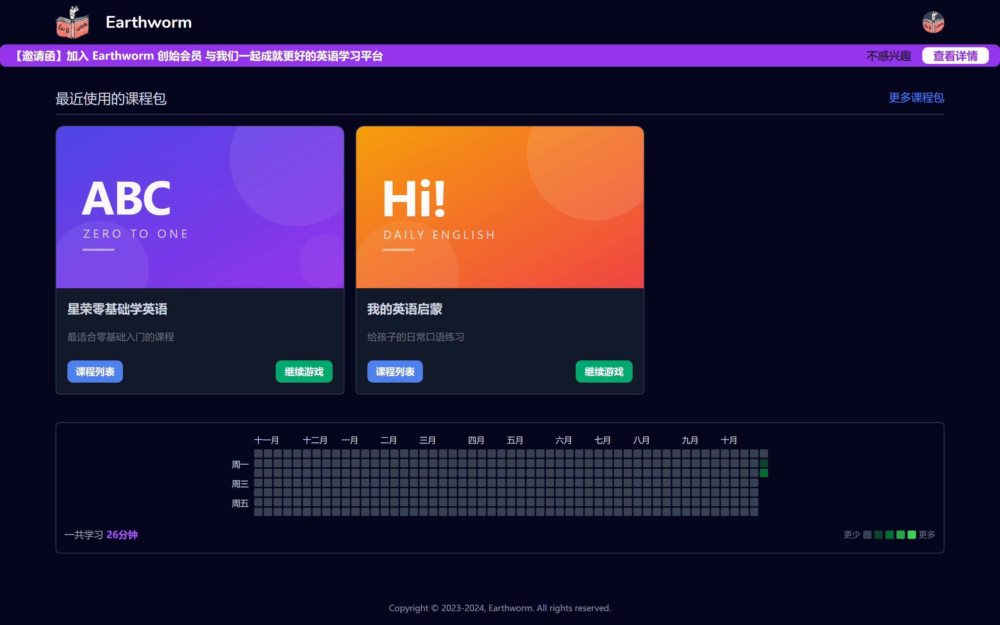
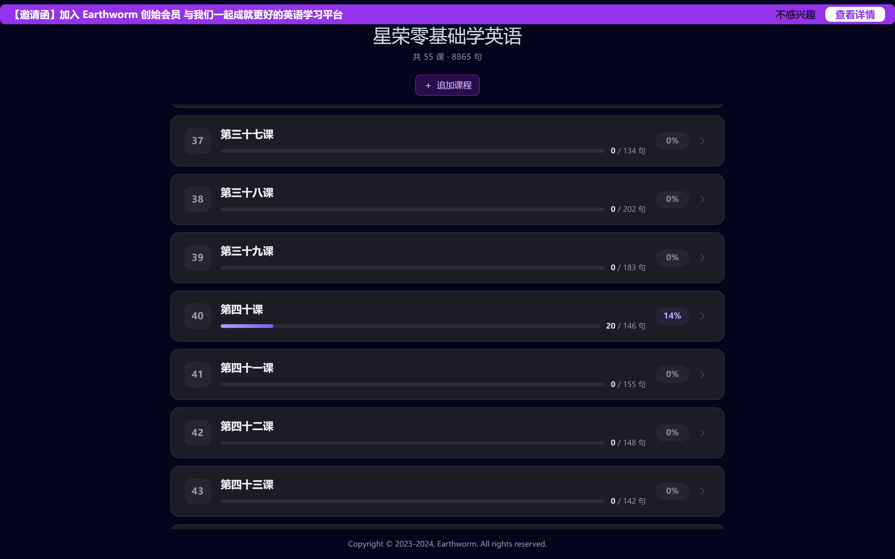
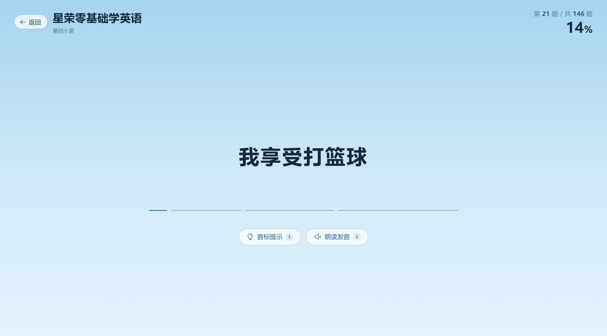
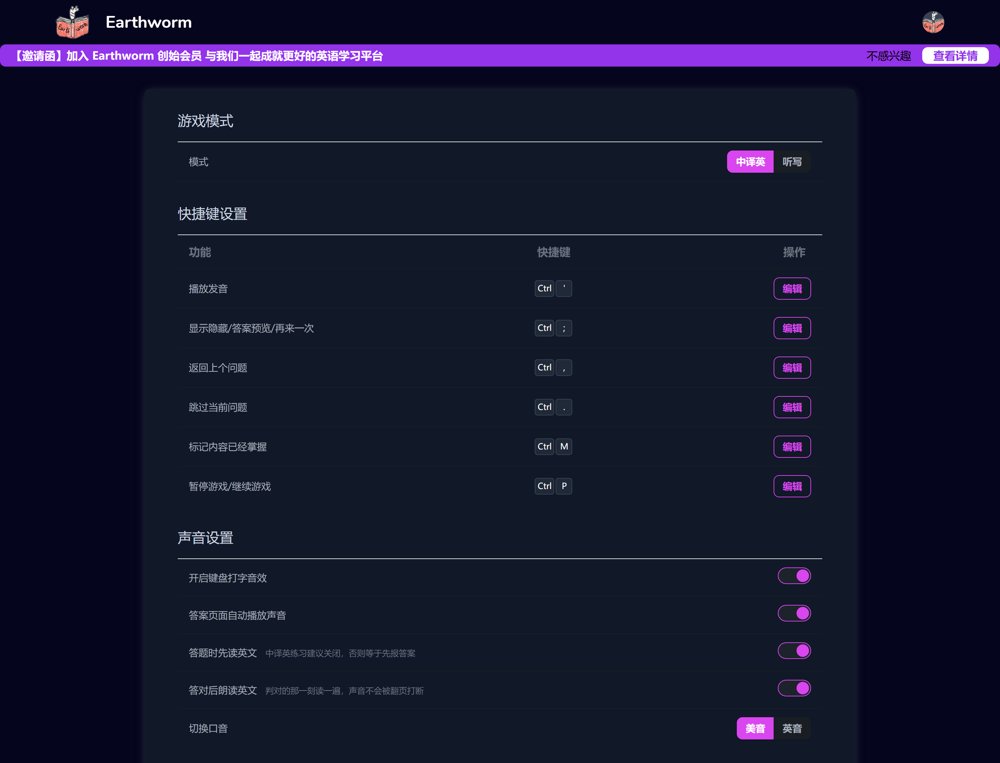
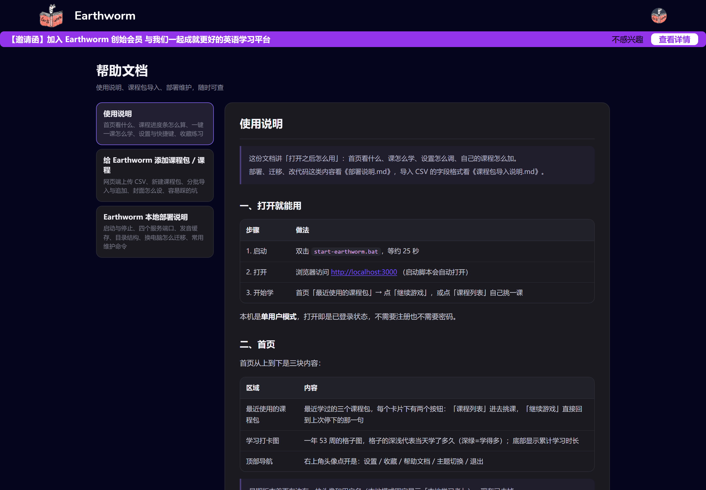

<div align="center">
  
  <h1>Earthworm · 本地版</h1>
  <p>用「连词构句」学英语 ——<br/>改造成所有数据都留在自己电脑上的单机版</p>
  
</div>

## 这是什么

[Earthworm](https://github.com/cuixueshe/earthworm)（蚯蚓英语）的重度改造版。
上游是标准 SaaS 形态：Logto 登录、Docker 起库、课程写死在代码里。
这个版本把它拆成了一个**双击就能用、不需要联网、不需要账号**的本地学习工具：

- 免登录，只有一个本地学习者身份
- 用免安装的 PostgreSQL + Redis，不用 Docker、不需要管理员权限
- 课程包可以自己导入 CSV、可以新建、可以分多批往同一个包里追加
- 发音换成微软神经网络语音（与 Azure TTS 同一套声学模型），全库预生成为本地 mp3
- 界面重做：深/浅色主题、课程进度条、收藏本、站内帮助文档

> 上游原始说明（Docker + Logto 的开发方式）仍然适用，见 [上游仓库](https://github.com/cuixueshe/earthworm)。
> 想了解本地部署细节请看 [部署说明.md](./部署说明.md)。

## 截图

| 课程列表（带学习进度）                          | 学习页                                 |
| ----------------------------------------------- | -------------------------------------- |
|  |  |

| 设置项                                   | 站内帮助                             |
| ---------------------------------------- | ------------------------------------ |
|  |  |

## 相对上游做了什么

| 方面     | 改动                                                                                     |
| -------- | ---------------------------------------------------------------------------------------- |
| 认证     | 去掉 Logto，改为 `LOCAL_MODE=true` + 固定 token 的本地身份                               |
| 运行环境 | PostgreSQL 16 / Redis 5 免安装版随仓库外置，`start-earthworm.bat` 一键拉起 4 个服务      |
| 发音     | 有道 `dictvoice`（单词录音拼接）→ 微软 Edge 神经语音，磁盘缓存 + 全库预生成，命中约 76ms |
| 课程     | CSV 导入器 + 课程包新建 + 分批导入（可指定并入已有包、可勾选单节课）                     |
| 进度     | `user_course_progress` 唯一键细到「一节课一条」，课程列表显示进度条与百分比              |
| 界面     | 首页/课程列表/学习页/设置页重做，支持深色模式、手机端；新增收藏本、站内帮助              |
| 数据     | 内置 55 课 / 8865 句的《新概念》语料，导入后按句去重建库                                 |

## 快速开始（Windows）

前提：**Node.js ≥ 20**、**pnpm ≥ 8**。

```bash
pnpm install
cp apps/api/.env.example apps/api/.env       # Windows 用 copy
cp apps/client/.env.example apps/client/.env

pnpm schema:build                             # 生成 drizzle schema
pnpm -F api build                             # 后端产物 apps/api/dist
pnpm -F client build                          # 前端产物 apps/client/.output
```

首次建库（空库要初始化表结构 + 导入语料）：

```bash
pnpm db:init
pnpm db:upload          # 导入内置 55 课语料
```

然后双击 **`start-earthworm.bat`**，等约 25 秒自动打开 http://localhost:3000 。
停止用 `stop-earthworm.bat`。

### 关于 `tools/pgsql`、`tools/redis`

这两个目录是免安装的数据库程序本体（约 170MB），**没有放进仓库**（见 `.gitignore`）。
一键脚本默认从下面两个位置启动它们：

| 需要的程序             | 放哪里                                  | 下载                                                                      |
| ---------------------- | --------------------------------------- | ------------------------------------------------------------------------- |
| PostgreSQL 16 免安装版 | `tools/pgsql/`（含 `bin/postgres.exe`） | [EDB Binaries](https://www.enterprisedb.com/download-postgresql-binaries) |
| Redis for Windows 5.x  | `tools/redis/`（含 `redis-server.exe`） | [tporadowski/redis](https://github.com/tporadowski/redis/releases)        |

也可以不用一键脚本，直接用本机已装的 PostgreSQL / Redis，改 `apps/api/.env` 里的连接串即可，
或者沿用上游的 `docker-compose.yml`：

```bash
docker compose up -d      # 5433 / 6379
pnpm dev:serve            # 后端 dev
pnpm dev:client           # 前端 dev
```

### 神经语音（可选）

发音需要 Python 环境里的 `edge-tts`：

```bash
pip install edge-tts
```

`apps/api/.env` 里 `TTS_PYTHON` 不填则用 PATH 上的 `python`。
服务启动 15 秒后会自动补齐缺失音频（`TTS_AUTO_PREWARM=true`），也可以手动触发：

```bash
curl -X POST http://localhost:3001/tts/prewarm          # 全库补齐
curl http://localhost:3001/tts/prewarm/status           # 看进度
curl -X POST http://localhost:3001/tts/cache/purge      # 清缓存
```

关掉语音（`TTS_ENABLED=false`）也不影响使用，会自动降级到浏览器 `speechSynthesis`。

## 数据在哪 / 怎么备份

| 内容                 | 位置                                   |
| -------------------- | -------------------------------------- |
| 学习记录、课程、进度 | `tools/pgdata/`（PostgreSQL 数据目录） |
| 句子音频缓存         | `storage/tts/<hash前2位>/<hash>.mp3`   |
| 上传的封面           | `apps/client/public/covers/`           |

换电脑时：先 `stop-earthworm.bat` 正常关闭数据库，再整包拷走，在 `tools/` 放回
PostgreSQL / Redis，`pnpm install` 后重新构建即可。

## 文档

| 文档                                     | 内容                                                                               |
| ---------------------------------------- | ---------------------------------------------------------------------------------- |
| [使用说明.md](./使用说明.md)             | 面向使用者：首页、课程列表、怎么学一节课、发音、设置、收藏、加自己的课程、常见问题 |
| [课程包导入说明.md](./课程包导入说明.md) | CSV 格式、命令行导入、分批导入、封面怎么设                                         |
| [部署说明.md](./部署说明.md)             | 一键启动、端口、目录结构、数据库结构变动、维护命令                                 |
| [界面改版说明.md](./界面改版说明.md)     | 历次界面改版的实现记录（设计取舍、踩过的坑）                                       |

站内也有同样的文档：打开 http://localhost:3000/help 。

## 目录结构

```
earthworm/
├── start-earthworm.bat / stop-earthworm.bat   一键启停
├── apps/api/            NestJS 后端（3001）
├── apps/client/         Nuxt 3 前端（3000）
├── packages/schema/     drizzle 表结构
├── packages/xingrong-courses/  语料与 CSV 导入器
├── tools/
│   ├── tts-worker/      edge-tts 常驻合成进程
│   ├── build-help-docs.mjs      生成站内帮助文档
│   ├── build-wordinfo.mjs       生成逐词释义表
│   └── shot.mjs / test-answer-audio.mjs   截图与朗读回归脚本
├── docs/screenshots/    README 用图
└── storage/tts/         音频缓存（运行时生成，不入库）
```

## 版本

当前版本 **v0.1**，见 [Releases](../../releases)。
分支约定：`main` 为开发主线，`release/0.1` 为当前版本快照。

## 许可与致谢

本项目沿用上游的 **AGPL-3.0** 许可（见 [LICENSE](./LICENSE)）。
原始项目：[cuixueshe/earthworm](https://github.com/cuixueshe/earthworm)，
界面与课程语料的大部分功劳属于原作者与贡献者。
